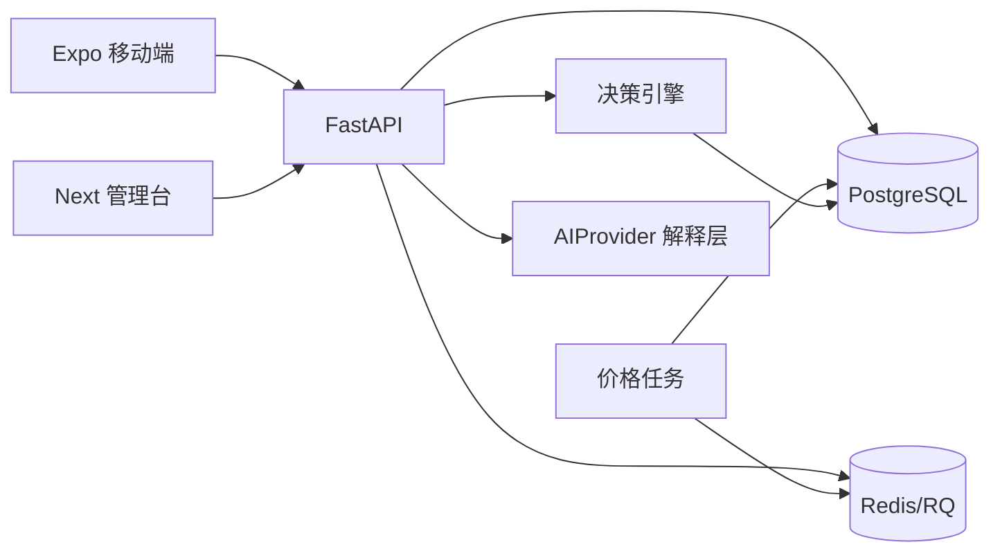

# 架构

移动端只访问 FastAPI，不直连数据库。API 以规范化商品/规格/价格模型作为事实源，依次执行硬约束过滤、FitScore、ValueScore、PriceScore、RiskScore 和最终排序；AIProvider 仅负责解释。PostgreSQL 是目标数据库，SQLite 仅供零配置本地演示。Redis/RQ 用于价格检查和通知任务。

事实来源和商业归因分离；Affiliate 表不参与推荐排序。低置信度匹配不会静默合并，而是进入人工复核状态。

